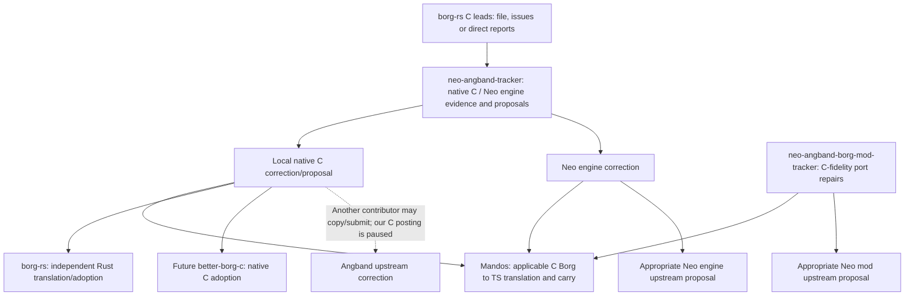

# Repository reorganization: purpose, implementation and review dossier

Prepared 2026-11-05T20:18:30+00:00. This is the coordinator's factual handover/review dossier,
not an independent approval. The implementation has been merged; an independent
review is requested and remains pending. The reviewer must write a separate
file as specified in [REVIEW-REQUEST.md](REVIEW-REQUEST.md).

This umbrella directory is **not** a git repository or a fourth implementation
session. The three managed sessions are the repositories below. The owner
explicitly authorized the cross-repository reorganization and review.

## 1. What the owner wanted, and the resulting boundary

The owner wanted three independent sessions: fix the original C Borg/Angband
and Neo engine, fix the Neo Borg TypeScript port, and develop/adopt fixes in
Mandos. A single Angband fork network must accommodate the C and Neo engine
source trees, so those responsibilities share one repository but use different
branches, worktrees, build systems and proposal bases.

The important distinction is **source correction versus downstream consumption**.
A source tracker proposes/evidences a correction. A consumer applies or
translates it and owns its own application, verification and carry lifecycle.
A source issue must not masquerade as a downstream application receipt.

Earlier intermediate ideas said Neo Borg development remained entirely in
Mandos or treated all forks as PR-only vehicles. Those were superseded by the
owner's final three-session split. Old documents are preserved as historical
snapshots; the current root AGENTS/RULES/PLAN and checkpoints govern.

## 2. Repository purposes

### 2.1 `diegoami/neo-angband-tracker`

URL: https://github.com/diegoami/neo-angband-tracker

It has **two responsibilities**, stated explicitly in README:

1. **Original Angband:** the C game and especially the C Borg. It owns canonical
   C findings/candidates, native evidence, duplicate/provenance investigation,
   C patch proposals and the C-side source-monitoring work.
2. **Neo Angband proper:** the TypeScript game engine/API, not its Borg mod.
   It owns engine defects and isolated proposals to neostryder/neo-angband.

One fork contains both source families. Default master is the Neo engine
source plus our tracker/bootstrap material. `c-borg-reference` is separately
pinned original C source. `workbench/c-borg` adds session entry docs to that
native tree. Actual source repair branches start from the appropriate pristine
upstream reference, **not** our documentation-bearing workbench/default.

C proposals remain in our fork. The standing owner pause on submissions to
`angband/angband` still applies: no issues, PRs or comments there from us.
Another contributor may copy/submit our C proposals. Confirmed Neo engine
reports/offers retain their appropriate authorized Neo route after proof and
duplicate checks. This repository is a repair/tracker, not an automatic game
release publisher or an upstream C maintainer commitment.

### 2.2 `diegoami/neo-angband-borg-mod-tracker`

URL: https://github.com/diegoami/neo-angband-borg-mod-tracker

It owns the Neo Borg TypeScript port's source defects, parity investigations,
regressions and isolated offers to the actual upstream mod repository:
`neostryder/neo-angband-mod-borg`. Its purpose is fidelity to the **explicitly
pinned C Borg baseline**, not to a hypothetical improved C Borg.

An omitted/different implementation of valid C behavior is a port defect.
A bug faithfully reproduced from C is a C-source issue, not a fabricated port
omission. This session must not become a service that translates proposed C
corrections into the fidelity-only mod. C and Neo engine implementation work
is routed to the combined tracker. Mandos-specific policies/strategy packs,
lab deployment and derivative behavior are not implemented here.

### 2.3 `diegoami/mandos`

URL: https://github.com/diegoami/mandos

It owns Mandos-specific development/bugs, its class-agnostic derivative and
packs, play/run/postmortem/replay/archive tooling, lab integration and actual
consumer adoption. Current backlogged gameplay strategies/learning/new
unattended stage-resume features remain parked unless explicitly authorized;
reorganization alone did not authorize those features.

Mandos adopts delivered port/Neo engine fixes. It also establishes whether a
**C Borg correction has a corresponding TS path**, translates the correction
into its own derivative, and proves the change against the Neo runtime using
declared APIs. A faithful C behavior changed before baseline alignment is an
explicitly marked Mandos divergence, not an upstream port omission.

A C game correction requiring Neo engine implementation belongs in the
combined engine tracker; Mandos consumes that engine correction/backport.
Mandos does not embed private engine implementation or privileged reads.
No corresponding TS path means **not applicable**, not an invented translation.

Source bugs stay on the source tracker; Mandos has linked adoption/translation
issues, plus genuinely Mandos-only issues. A Mandos-only bug does not need a
fictional upstream dependency before it may close.

### 2.4 Independent `borg-rs` peer

URL: https://github.com/diegoami/borg-rs

borg-rs is both a source of C leads and an independent consumer that can
translate/adopt C corrections into Rust. It has **no Neo responsibility**.
This task did not reorganize its source, implement Rust corrections or push
Rust commits. A sparse fetch-only reference clone was created; push is disabled.

The combined tracker must monitor the current file, an issue feed, and any
future direct reports into our C tracker. It must not assume a bug file will
remain the permanent interface. Source URLs/commits/CBUG IDs, evidence levels
and duplicate checks survive a file-to-issues transition.

### 2.5 Future `better-borg-c` — agreed consumer convention, not created

The owner raised a future maintained native-C Borg containing fixes and its
own improvements. The recommendation was a separate **product/consumer** repo
for a maintained/released product, with a tracker branch useful only for an
experiment. With the stated one-fork constraint, a separate product can be an
independent repository imported from C history; upstream offers still travel
through the tracker fork's isolated branches. No such repo/branch was created.

The owner agreed it would follow the same connected-source/consumer convention:
canonical C issue in neo-angband-tracker; linked native-C consumer issue in
better-borg-c; carried/open when fixed only on its side; fixed/closed only after
upstream correction plus verified downstream adoption. Its own improvements
and regressions belong in its own board. It consumes C directly, rather than
performing a C→TS/Rust translation, and has no need to consume Neo engine fixes.
The three managed Neo sessions have not silently become four product sessions.

## 3. Source-to-consumer flow



The source issue owns the defect/proposal. Each consumer owns its distinct
local application/translation/deployment receipts. Linked scopes are not two
competing copies of the same live bug status.

## 4. Exact session roots, branches and entry points

| Session/tree | Local path | Persistent branch | Published head at cutover |
| --- | --- | --- | --- |
| Mandos | `<ANGBAND_WORKSPACE>/better-borg` | main | `a783c2535cf4eee7bc61f2e1cfda329543ed0ee3` |
| Combined engine/C primary | `<ANGBAND_WORKSPACE>/neo-angband-tracker` | master | `81d2fc873472014e3ba870b4e115bf4bfa0cf484` |
| Native C tree of that same session | `<ANGBAND_WORKSPACE>/neo-angband-tracker/.worktrees/angband-c` | workbench/c-borg | `23aaf89aea93592227ff807f647fb3e68ad81998` |
| Port repair | `<ANGBAND_WORKSPACE>/neo-angband-borg-mod-tracker` | master | `33552ab8504f5431d02f63a3b340757a47739661` |

The native tree shares the combined tracker's `.git` common directory. It is
not a fourth git repository or an independently owned issue queue.

Each repository has AGENTS.md, RULES.md, README.md, PLAN.md, a thin CLAUDE.md
import, session.json, source-review tools and an open checkpoint. PLANNED.md
now routes to the current plan rather than acting as copied feature authority.
Original technical/readme/planning material and licences/credits remain
available in explicit reference/history locations. Root source rules override
old snapshots as the active session contract.

Current startup checkpoints:

- Combined tracker25: https://github.com/diegoami/neo-angband-tracker/issues/25#issuecomment-6668059805
- Port tracker26: https://github.com/diegoami/neo-angband-borg-mod-tracker/issues/26#issuecomment-6668060261
- Mandos36: https://github.com/diegoami/mandos/issues/36#issuecomment-6668060683
- Organisational review issue2: https://github.com/diegoami/neo-angband-tracker/issues/2 (open, status:in-review; independent approval pending).

The umbrella AGENTS.md and SESSIONS.md route to these roots. A specifically
owner-requested cross-repository review may read all three, but may not select
an unrelated implementation task from the umbrella.

### Protected older checkouts and data

- `neo-angband`: existing lab checkout/branch, deliberately left at its older
  intentional build (`9d6ae21ec`, runtime1.23.0-beta.2-mandos.2).
- `neo-angband-upstream`: pristine Neo engine reference, not the new workbench.
- Original `neo-angband-mod-borg`: pristine upstream reference, not the new
  port workbench.
- `mandos-lab-data`: owner browser/profile/save/archive data; not migrated or
  redeployed. Installed lab mod remains the intentional older `48405e9`.
- `borg-rs-reference`: sparse docs/reference clone, not a Rust development
  session; origin push URL is `DISABLED`.

Only fork remote URLs in the old references/lab were canonicalized. Their
branches, gameplay source and owner data were not repurposed by this task.
A source merge does not mean the running lab was refreshed.

## 5. Naming, fork history and proposal bases

The old owned names were renamed in place:

| Old name | Current name | GitHub numeric repository ID |
| --- | --- | --- |
| diegoami/neo-angband | diegoami/neo-angband-tracker | 1443412722 |
| diegoami/neo-angband-mod-borg | diegoami/neo-angband-borg-mod-tracker | 1443412775 |

Repository identity/fork relationships were preserved; old repository links
redirect. The source fork remains connected to the original Angband network.
The default Borg fork master had lagged48 commits; it was first fast-forwarded
1fa2f8d→74a017d, with all four proposal heads verified unchanged. The engine
fork default was fast-forwarded836b8da2→0cc75b4a before bootstrap docs.

**Defaults now intentionally contain owned session docs.** They must not be
force-reset to a pristine upstream mirror. Integrate future upstream changes
by normal history-preserving merge as needed. Refresh pristine remote source
references separately. Source fix/proposal branches exclude bootstrap commits.
No amend, force-push, moved/deleted tag or overwritten proposal head was used.

Base selection:

- Neo engine proposal: `upstream/master` from neostryder/neo-angband.
- Neo port proposal: `upstream/master` from neostryder/neo-angband-mod-borg.
- Native C proposal: `angband/master` at the recorded C pin, not Neo master.
- `c-borg-reference` remains `e473720ed88a0f0c7ca66815cef3000eb4a38bc3`.
- Imported C4.2.6 comparison is `f3082213b73f3e463e3d0d60bff4b00462beae6e`;
  current C and this imported baseline can differ. Original port import
  boundary70145c5 and refreshed upstream74a017d are separate references.

A source fix is reproduced on its declared environment; source-only code
comparison is not a native game-outcome claim. A faithful C defect is not a
Neo port omission merely because it affects the TS derivative too.

## 6. Issue migration and authoritative state

47 existing issues were actually transferred:22 to the combined tracker and
25 to the port tracker.46 Mandos-owned records from the original93-issue
inventory stayed in Mandos (implementation/integration, measurements, product
history, unresolved local investigations and parked own roadmap work).

GitHub changes destination issue identifiers on transfer. Both old and new
identifiers/URLs are recorded. Creation timestamps, titles, state, discussion
counts and captured authorship were checked. Labels were pre-provisioned and
verified/restored where transfer responses were eventually consistent. All47
old REST issue URLs were subsequently verified to resolve to their canonical
new locations. This was not an approximation by copying/deleting discussions.

Known Mandos shorthand/relative body references were qualified where possible;
original comments and investigation history remain intact. Historical bare
references still require their original context; new active source/consumer
headers and Threads links are authoritative. Do not reinterpret every old
bare number as a new issue number in the destination repository.

There are152 distinct canonical C finding issues. Nine existing trackers were
reused and143 individual issues created (134 for previously unmaterialized
catalogue entries, then9 for the new group41). Meta/intake/validation tasks
remain distinct and are not counted as duplicate finding identities.

The C issue list filter is:
https://github.com/diegoami/neo-angband-tracker/issues?q=is%3Aissue+label%3Aupstream-c+label%3Afinding

### Source issue versus consumer issue

Source tracker issues use source/upstream resolution state and proposal/evidence
labels. **carried, fixed, partially-carried, not-carried and patch-active are
not source-issue tags.** Those label definitions/assignments were removed from
both source trackers.

26 linked consumer/adoption issues were created in Mandos125–150; bidirectional
source↔consumer links and original application states were verified. Relevant
original Mandos release milestones were retained on the linked consumer work.
This restores our actual consumer receipts without treating them as source state.

At the split, the consumer snapshot was:

-5 carried/open;
-5 partially-carried/open;
-1 not-carried/open;
-15 previously verified fixed/closed.

These are dated audit counts; live state belongs on each issue.

| Consumer state | Meaning |
| --- | --- |
| carried | Corrected and verified on our side at named revisions; remains OPEN while upstream correction/delivery is missing. |
| fixed/closed | The correction is fixed upstream AND pulled/adopted downstream with our changes, rebuilt and verified for the required consumers. |
| partially-carried | Incomplete scope; remains open and must not claim fully corrected on our side. |
| not-carried | No complete applicable local correction; remains explicit/open where work applies. |
| patch-active | Independent required consumer backport maintenance, even on a closed verified-fixed consumer issue. |

No published-release wait alone is required for closure, but upstream thread
closure alone is insufficient. A proposal branch/file is not an applied fix.
A source merge is not deployment. A Mandos-only regression has no invented
upstream dependency and can close after its own proved correction.

Integration queue111 was rewritten to own downstream work only. The two source
streams operate independently within their component queues; the older global
rule making C wait for the port queue to empty is superseded by the owner’s
three-session arrangement.

## 7. C documentation, evidence and source ingestion

The C landing page and connected material moved to the combined tracker:

- `docs/C-BUGS.md` is a short direct-compare/issue-list entry, not another live
  list/status ledger.
- Direct proposal example is the easy path:
  https://github.com/angband/angband/compare/master...diegoami:neo-angband-tracker:pr/c-borg-map-dump-cancel
- `docs/c-fix-handoff.md` holds own-fork copy, patch/report-only alternatives,
  permissions, attribution and result-discovery details separately.
- `docs/c-bugs/findings/CBUG-NNNN.json` and catalogue.json preserve split
  import/provenance material. `evidence_at_import`, `status_at_import`,
  `proposals_at_import` and `next_at_import` are historical, not live status.
- A generated data-only watch-index.json maps source contexts/issues; it is
  derived, not another mutable bug database.
- Native B94 evidence and `patches/upstream-c/B94-map-dump-cancel.patch` are
  canonical there. Old Mandos copies remain frozen so report links survive.
- Mandos C pages/raw-JSON location file/CLI are compatibility pointers. A client
  expecting the old monolithic JSON must follow the new location/schema.
  Mandos verify no longer owns the C snapshot gate; the source tracker does.

Evidence categories at import:1 independently reproduced native C-game outcome,
1 flags-only reproduction,18 source checks and132 reported leads. **152 findings
are not152 independently proved practical C bugs.** A native C baseline unit
pass does not validate each candidate’s consequence. Before a validated C
proposal, prove legal reachability, practical effect, source/options/RNG/perception
and before/after plus negative controls. Check duplicates in relevant open and
closed upstream history. Debug/manual, harmless/dead branches and unproven
bounds must remain qualified.

Source snapshot progressed from40 groups/141 leaf reports/143 observations to
41 groups/150 leaf reports/152 observations. The read-only borg-rs watch found
the appended debug-command group41 and nine explicitly reported candidates
were added. Source commit c375a82456741f7e4d4d410b27390ba68077ba9c, blob
0f82fe3c5a85a4f409e5ee1f447ff100cf43c06b. Earlier snapshots were retained;
quoted report ranges/current source correspondence and group/bullet coverage
are checked offline. Original lead pins remain recorded.

### borg-rs file/issue/direct-report contract

`tools/borg-rs-watch.mjs` handles file-and-issues, file-only, or an available
issue feed after file removal. At last read, main had the41-group file and an
enabled but empty issue feed. It compares source head/blob/digest, flags changed
claims and issues for classification, and retains the last successful baseline
on API/window failure. It never auto-promotes a claim, opens/closes source bugs,
applies/translates fixes, pushes Rust code or submits C upstream.

Direct reports in our C tracker use source:borg-rs plus C route/evidence/candidate
labels and original source IDs/pins. Deduplicate by existing CBUG/source issue/
anchor first. A Rust panic or Rust-reported C harness outcome is source-reported
until independently classified/proved here; Rust-only bugs are not C bugs by fiat.

The Rust peer owns its Rust correction/consumer receipts. Mandos owns its TS
translation/adoption receipts. The fidelity-only Neo mod is not assigned either
C-correction translation service. No consumer acquires a Neo duty just because
the canonical C tracker also houses Neo engine work.

## 8. Monitoring and bootstrap controls

`upstream-watch.mjs` discovers all three canonical boards with qualified
repository+issue identity. Source issues are observed directly by updatedAt,
including direct posts with no outgoing thread. Linked Mandos consumers are
audited for their own state; source consumer tags are rejected. API results
are memoized within a run to avoid duplicate outgoing reads. Incomplete board
discovery does not advance the baseline. Old fork aliases normalize to new names.

`c-upstream-watch.mjs` reads the combined tracker’s canonical watch index (local
in that repository, data-only GitHub fetch from other sessions), official C head
and linked official C threads. Its latest100 of230 Borg PR discovery window is
**not** an exhaustive historical duplicate search. Source-context movement is a
review signal, not an automatically accepted fix.

At final cutover the global watch covered176 open-or-patch-active source/consumer
records and72 outgoing refs, with no consumer missing a source/proposal link.
C evidence candidates are a different concept from a missing-link record.
Large source-header movement was our migration clarification; Neo PR66 movement
was inspected as metadata-only, still open at the unchanged e71bd21 head.

Every session reads its own checkpoint, refreshes sources/status, triages and
works only within its responsibility. The shared local heavy-job mutex is
`/tmp/angband-validation.lock`; long gates are logged/watched. User-directed
cross-repository setup/review is an explicit exception to ordinary task isolation.
A separate independent model is not silently dispatched; the owner chooses it.

## 9. Validation, review corrections and remaining failures

**Review R3 correction:** The table below records the passing PR run
[42092779990](https://github.com/diegoami/neo-angband-tracker/actions/runs/42092779990),
not a green post-merge master. Master run
[42096005784](https://github.com/diegoami/neo-angband-tracker/actions/runs/42096005784)
failed the character-sheet play-smoke check; its test job passed.
[Tracker issue 171](https://github.com/diegoami/neo-angband-tracker/issues/171)
records the suspected flake and required attribution. See [review response](REVIEW-RESPONSE.md).

| Surface | Recorded result |
| --- | --- |
| Mandos full local gate |1143passed,0skipped,202.53s; plugin unchanged/current730.6KiB |
| Mandos final PR CI |both verifies and privacy/GitGuardian checks passed |
| Shared source/consumer watch regressions |8passed, including namespace collision, source consumer-tag rejection and incomplete discovery |
| Native source snapshot/intake guards |8passed under Node |
| Original engine doc contracts after correction |52/52passed |
| Full original engine CI |14143passed/12existing skips;716files passed/3skipped; live-game job passed |
| Native C alltests |965/965 unit and5/5 upstream frontend tests passed |
| Published port baseline with content |862passed/4known repeated-open failures,0skips,73.83s |
| Same10-case port play/rest group on existing patched engine |10/10passed,128.30s |
| Live structural/data audit |47transfers/redirects,26consumer links,152finding links,4bootstrap trees checked |

The published port failures are retained source work in tracker issue25, linked
to Mandos consumer150. With no sibling content, the original source baseline
skips36 cases; green CI in that context does not establish execution. The
paired control used the same port/content and explicitly selected the existing
lab engine version/patch bundle. It narrows the runtime boundary **as a bundle**,
not an individual-hunk proof. Do not invent another port bug, change assertions/
seeds, or hide relevant skips. Future attribution remains necessary.

Corrections caught by review:

1. CMake test instructions initially used CTest; this project uses custom
   alltests/allunittests. Corrected instructions were exercised with actual C.
2. Node-native guard tests could enter engine Vitest. Renamed .node-test.mjs
   and kept explicit Node CI commands; `.worktrees` excluded from test/lint
   collection. Collection review found719 engine files, no Node-only guards or
   nested worktrees.
3. Mandos hook proxies depended on the old lab path. They now prefer the new
   tracker workspace, retain explicit/legacy fallback, and were exercised by a
   real staged privacy scan/commit. Thin CLAUDE imports are intentionally tracked.
4. Source carry tags conflated source and consumer state. Removed them from
   both source forks and created the26 linked Mandos consumer records.
5. A file-only Rust intake would lose a future interface transition. Dual-feed
   capability/failure tests and a push-disabled reference were implemented.
6. Rewritten engine README/CONTRIBUTING omitted three existing contracts.
   Restored pinned pnpm version and concise macOS Privacy & Security/Open Anyway/
   Apple Silicon arm64 facts without weakening the original tests. Full CI passed.
7. Inherited automation could publish products or redirect our issues. Contained
   as described next; this was an operational rework finding, not a gameplay fix.

Dependency installation also set executable bits on two existing SDK bin
wrappers. Contents were unchanged; tracked modes were restored before handover.
Native records/run records were not rewritten. Runtime source diffs against
pristine component bases are empty (apart from intended test/lint collection
configuration and operational/session tooling).

## 10. Automation incident and current settings

**Review R1 correction:** The following paragraphs preserve the original account,
which incorrectly claimed complete settings containment and no Pages deployment.
Neo release.yml/publish-npm.yml/pages.yml/mod-canary.yml were unregistered,
not disabled. PR 172 adds repository guards to all inherited jobs; active
[version-tag ruleset 26648434](https://github.com/diegoami/neo-angband-tracker/rules/26648434)
blocks v* tag creation/update/deletion without bypass. Pages did redeploy the
same gh-pages content at 17:59Z. Fork-only v1.23.0-edge.209 points at 836b8da2;
origin unknown and tag retained. Mandos GitHub-release stays active; its Nexus
workflow is active but its existing upstream-only job guard skips this fork.
See [review response](REVIEW-RESPONSE.md#r1--publishing-containment) for exact mechanisms.
The earlier claim below is superseded by this correction.

The initial engine fork master sync to0cc75b4a triggered inherited `edge`
automation, producing a prerelease at2026-11-05T17:30:27Z. This was not an owner-
requested product release and should have been checked before syncing master.
It is now **draft**, with original `v1.23.0-edge.1` tag, target commit and four
assets preserved. No tag was moved/deleted to conceal it.

In our tracker settings, active edge/create-release, mod GitHub-release,
Nexus-publish and inherited redirect-to-neostryder issue workflows were disabled.
CI/privacy/fork-session checks stay enabled. The managed legacy Pages workflow
could not be disabled directly; the site was switched from gh-pages branch
auto-build to workflow-only mode, preserving the existing site/branch. No new
Pages deployment was performed. Audit new inherited automation on future source
merges; product publication/redirects need explicit owner direction.

The operational receipt is docs/migrations/tracker-automation.json in Mandos.
This is settings containment, not deletion of upstream workflow source. Some
upstream tag/release/manual workflow files remain as source/reference material;
reviewers should verify actual active settings and triggers, not infer policy
solely from their presence. No Nexus/npm product upload or official C submission
was performed by the coordinator.

## 11. Environment setup and safety

The combined engine source expects Node26 (`.nvmrc`) and pnpm12.3.4
(packageManager). Node26.13.0 and that pnpm were installed in the user environment;
workspace dependencies were installed with ELECTRON_SKIP_BINARY_DOWNLOAD=1 as
unit CI does. This does not claim a fresh Electron/browser desktop deployment.
The source Node-only audit tools also run on their smaller CI Node line.

CMake3.31.10 was installed as a user tool with uv; GCC/Make/pkg-config were
already available. The native configured/build/test directory is
`/tmp/angband-tracker-bootstrap-configure`, not the owner lab. Published port
core/SDK beta.1 and Mandos core/content/SDK beta.2 plus its existing patch are
separate declared environments. Mandos's trap fingerprint remains
`34c27241f96aceff581bcb186a9d898f`.

No source merge was represented as lab deployment. Owner saves, browser data,
archive/profile, old live lab branch and original pristine references were not
repurposed. Independent sessions must continue honoring that boundary.

## 12. Published rework and evidence locations

Merged implementation PRs:

- Combined primary bootstrap169: https://github.com/diegoami/neo-angband-tracker/pull/169
- Native C workbench170: https://github.com/diegoami/neo-angband-tracker/pull/170
- Fidelity port bootstrap27: https://github.com/diegoami/neo-angband-borg-mod-tracker/pull/27
- Mandos migration/adoption151: https://github.com/diegoami/mandos/pull/151

Durable coordinator review/ledgers in Mandos:

- docs/migrations/review.md and review-receipt.json;
- repository-split.json (including retained/moved rationale and ID history);
- repository-renames.json;
- c-finding-issues.json (including additional group41 import);
- consumer-adoption-issues.json;
- tracker-automation.json.

Historical pre-split policies are in docs/history/repository-split. Original
upstream technical docs are in the source forks' docs/upstream-reference.
Mandos C pointers and old native receipts remain for compatibility; current C
proposals/patches/evidence belong in the combined tracker.

Bulky local receipts under better-borg/artifacts include migration-mandos-verify,
migration-native-alltests, migration-port-verify, migration-port-patched-control,
engine-doc-contracts-fixed, engine-bootstrap-ci-success, three-repo-review,
transfer-redirect-audit, upstream-pr-final-audit, split-final-global-watch,
split-final-c-watch and split-final-borg-rs-watch. These scratch logs are not an
alternative durable queue; important conclusions are on issues/checkpoints.

Original proposal validity at final verification: engine PR429/432/433/442 and
mod PR63–66 are all open/mergeable at unchanged heads. C proposal1 remains
closed/unmerged, commit540f621, based on e473720, one changed C file. Legacy
Mandos lighting wrapper88 is closed/unmerged with branch retained; its source
finding/validation work is in the combined tracker and practical impact is
still unproven.

## 13. Review status and remaining work

The implementation and coordinator consistency pass are complete. **Independent
approval is not claimed.** Organisational issue2 stays open/in-review for the
reviewer's verdict and any required changes.

Remaining source/consumer bugs were not solved by reorganizing them. Port25 /
Mandos150 retain runtime-boundary attribution; other pending source proposals
retain their original state and named consumer receipts. The source sessions
work their own queues after owner direction/review, without global C-vs-port
queue coupling. New borg-rs changes are classified on intake, not automatically
imported as proved C bugs. No future better-borg-c product was created.

### Independent reviewer output contract

Read REVIEW-REQUEST.md, inspect the actual three repositories and both source
trees, and write **your own** file in this same umbrella directory:
`REPOSITORY-REORGANIZATION-REVIEW.md` (or a reviewer-named variant if it already
exists). Use APPROVED, CHANGES REQUESTED or BLOCKED, with explicit scope/heads,
severity-ranked evidence, required versus optional changes, verification and
limits. Do not merely restate this report or treat the coordinator pass as
approval. Do not mutate source/issues/automation or begin unrelated bug work.

## Appendix A. Existing issue transfer map (dated audit snapshot)

Old URLs are actual checked redirects. Current state is on the destination issue.

| Original Mandos issue | Canonical source issue | Original state |
| --- | --- | --- |
| [#2](https://github.com/diegoami/mandos/issues/2) | [diegoami/neo-angband-borg-mod-tracker#1](https://github.com/diegoami/neo-angband-borg-mod-tracker/issues/1) | CLOSED |
| [#4](https://github.com/diegoami/mandos/issues/4) | [diegoami/neo-angband-borg-mod-tracker#2](https://github.com/diegoami/neo-angband-borg-mod-tracker/issues/2) | OPEN |
| [#11](https://github.com/diegoami/mandos/issues/11) | [diegoami/neo-angband-tracker#3](https://github.com/diegoami/neo-angband-tracker/issues/3) | OPEN |
| [#13](https://github.com/diegoami/mandos/issues/13) | [diegoami/neo-angband-tracker#4](https://github.com/diegoami/neo-angband-tracker/issues/4) | OPEN |
| [#14](https://github.com/diegoami/mandos/issues/14) | [diegoami/neo-angband-borg-mod-tracker#3](https://github.com/diegoami/neo-angband-borg-mod-tracker/issues/3) | CLOSED |
| [#34](https://github.com/diegoami/mandos/issues/34) | [diegoami/neo-angband-borg-mod-tracker#4](https://github.com/diegoami/neo-angband-borg-mod-tracker/issues/4) | OPEN |
| [#41](https://github.com/diegoami/mandos/issues/41) | [diegoami/neo-angband-tracker#5](https://github.com/diegoami/neo-angband-tracker/issues/5) | OPEN |
| [#42](https://github.com/diegoami/mandos/issues/42) | [diegoami/neo-angband-tracker#6](https://github.com/diegoami/neo-angband-tracker/issues/6) | OPEN |
| [#43](https://github.com/diegoami/mandos/issues/43) | [diegoami/neo-angband-tracker#7](https://github.com/diegoami/neo-angband-tracker/issues/7) | OPEN |
| [#44](https://github.com/diegoami/mandos/issues/44) | [diegoami/neo-angband-borg-mod-tracker#5](https://github.com/diegoami/neo-angband-borg-mod-tracker/issues/5) | CLOSED |
| [#45](https://github.com/diegoami/mandos/issues/45) | [diegoami/neo-angband-tracker#8](https://github.com/diegoami/neo-angband-tracker/issues/8) | OPEN |
| [#48](https://github.com/diegoami/mandos/issues/48) | [diegoami/neo-angband-borg-mod-tracker#6](https://github.com/diegoami/neo-angband-borg-mod-tracker/issues/6) | CLOSED |
| [#49](https://github.com/diegoami/mandos/issues/49) | [diegoami/neo-angband-borg-mod-tracker#7](https://github.com/diegoami/neo-angband-borg-mod-tracker/issues/7) | CLOSED |
| [#50](https://github.com/diegoami/mandos/issues/50) | [diegoami/neo-angband-borg-mod-tracker#8](https://github.com/diegoami/neo-angband-borg-mod-tracker/issues/8) | CLOSED |
| [#55](https://github.com/diegoami/mandos/issues/55) | [diegoami/neo-angband-borg-mod-tracker#9](https://github.com/diegoami/neo-angband-borg-mod-tracker/issues/9) | CLOSED |
| [#57](https://github.com/diegoami/mandos/issues/57) | [diegoami/neo-angband-borg-mod-tracker#10](https://github.com/diegoami/neo-angband-borg-mod-tracker/issues/10) | CLOSED |
| [#58](https://github.com/diegoami/mandos/issues/58) | [diegoami/neo-angband-borg-mod-tracker#11](https://github.com/diegoami/neo-angband-borg-mod-tracker/issues/11) | CLOSED |
| [#59](https://github.com/diegoami/mandos/issues/59) | [diegoami/neo-angband-borg-mod-tracker#12](https://github.com/diegoami/neo-angband-borg-mod-tracker/issues/12) | CLOSED |
| [#61](https://github.com/diegoami/mandos/issues/61) | [diegoami/neo-angband-borg-mod-tracker#13](https://github.com/diegoami/neo-angband-borg-mod-tracker/issues/13) | CLOSED |
| [#64](https://github.com/diegoami/mandos/issues/64) | [diegoami/neo-angband-borg-mod-tracker#14](https://github.com/diegoami/neo-angband-borg-mod-tracker/issues/14) | CLOSED |
| [#65](https://github.com/diegoami/mandos/issues/65) | [diegoami/neo-angband-borg-mod-tracker#15](https://github.com/diegoami/neo-angband-borg-mod-tracker/issues/15) | OPEN |
| [#68](https://github.com/diegoami/mandos/issues/68) | [diegoami/neo-angband-borg-mod-tracker#16](https://github.com/diegoami/neo-angband-borg-mod-tracker/issues/16) | CLOSED |
| [#69](https://github.com/diegoami/mandos/issues/69) | [diegoami/neo-angband-borg-mod-tracker#17](https://github.com/diegoami/neo-angband-borg-mod-tracker/issues/17) | CLOSED |
| [#72](https://github.com/diegoami/mandos/issues/72) | [diegoami/neo-angband-borg-mod-tracker#18](https://github.com/diegoami/neo-angband-borg-mod-tracker/issues/18) | CLOSED |
| [#75](https://github.com/diegoami/mandos/issues/75) | [diegoami/neo-angband-borg-mod-tracker#19](https://github.com/diegoami/neo-angband-borg-mod-tracker/issues/19) | CLOSED |
| [#79](https://github.com/diegoami/mandos/issues/79) | [diegoami/neo-angband-borg-mod-tracker#20](https://github.com/diegoami/neo-angband-borg-mod-tracker/issues/20) | CLOSED |
| [#80](https://github.com/diegoami/mandos/issues/80) | [diegoami/neo-angband-borg-mod-tracker#21](https://github.com/diegoami/neo-angband-borg-mod-tracker/issues/21) | CLOSED |
| [#81](https://github.com/diegoami/mandos/issues/81) | [diegoami/neo-angband-borg-mod-tracker#22](https://github.com/diegoami/neo-angband-borg-mod-tracker/issues/22) | OPEN |
| [#86](https://github.com/diegoami/mandos/issues/86) | [diegoami/neo-angband-tracker#9](https://github.com/diegoami/neo-angband-tracker/issues/9) | OPEN |
| [#87](https://github.com/diegoami/mandos/issues/87) | [diegoami/neo-angband-tracker#10](https://github.com/diegoami/neo-angband-tracker/issues/10) | OPEN |
| [#89](https://github.com/diegoami/mandos/issues/89) | [diegoami/neo-angband-tracker#11](https://github.com/diegoami/neo-angband-tracker/issues/11) | OPEN |
| [#93](https://github.com/diegoami/mandos/issues/93) | [diegoami/neo-angband-tracker#12](https://github.com/diegoami/neo-angband-tracker/issues/12) | OPEN |
| [#94](https://github.com/diegoami/mandos/issues/94) | [diegoami/neo-angband-tracker#13](https://github.com/diegoami/neo-angband-tracker/issues/13) | OPEN |
| [#95](https://github.com/diegoami/mandos/issues/95) | [diegoami/neo-angband-tracker#14](https://github.com/diegoami/neo-angband-tracker/issues/14) | OPEN |
| [#100](https://github.com/diegoami/mandos/issues/100) | [diegoami/neo-angband-tracker#15](https://github.com/diegoami/neo-angband-tracker/issues/15) | CLOSED |
| [#102](https://github.com/diegoami/mandos/issues/102) | [diegoami/neo-angband-tracker#16](https://github.com/diegoami/neo-angband-tracker/issues/16) | CLOSED |
| [#103](https://github.com/diegoami/mandos/issues/103) | [diegoami/neo-angband-tracker#17](https://github.com/diegoami/neo-angband-tracker/issues/17) | OPEN |
| [#104](https://github.com/diegoami/mandos/issues/104) | [diegoami/neo-angband-tracker#18](https://github.com/diegoami/neo-angband-tracker/issues/18) | OPEN |
| [#105](https://github.com/diegoami/mandos/issues/105) | [diegoami/neo-angband-tracker#19](https://github.com/diegoami/neo-angband-tracker/issues/19) | OPEN |
| [#106](https://github.com/diegoami/mandos/issues/106) | [diegoami/neo-angband-tracker#20](https://github.com/diegoami/neo-angband-tracker/issues/20) | OPEN |
| [#107](https://github.com/diegoami/mandos/issues/107) | [diegoami/neo-angband-tracker#21](https://github.com/diegoami/neo-angband-tracker/issues/21) | OPEN |
| [#108](https://github.com/diegoami/mandos/issues/108) | [diegoami/neo-angband-borg-mod-tracker#23](https://github.com/diegoami/neo-angband-borg-mod-tracker/issues/23) | OPEN |
| [#110](https://github.com/diegoami/mandos/issues/110) | [diegoami/neo-angband-tracker#22](https://github.com/diegoami/neo-angband-tracker/issues/22) | CLOSED |
| [#112](https://github.com/diegoami/mandos/issues/112) | [diegoami/neo-angband-tracker#23](https://github.com/diegoami/neo-angband-tracker/issues/23) | OPEN |
| [#114](https://github.com/diegoami/mandos/issues/114) | [diegoami/neo-angband-borg-mod-tracker#24](https://github.com/diegoami/neo-angband-borg-mod-tracker/issues/24) | OPEN |
| [#120](https://github.com/diegoami/mandos/issues/120) | [diegoami/neo-angband-tracker#24](https://github.com/diegoami/neo-angband-tracker/issues/24) | CLOSED |
| [#123](https://github.com/diegoami/mandos/issues/123) | [diegoami/neo-angband-borg-mod-tracker#25](https://github.com/diegoami/neo-angband-borg-mod-tracker/issues/25) | OPEN |

## Appendix B. Consumer link map (dated split receipt)

Labels below are the state at migration, not a second live status table. Each
linked Mandos issue is authoritative for subsequent consumer changes.

| Former tracker | Canonical source | Mandos consumer | State at split |
| --- | --- | --- | --- |
| Mandos4 | [diegoami/neo-angband-borg-mod-tracker#2](https://github.com/diegoami/neo-angband-borg-mod-tracker/issues/2) | [#125](https://github.com/diegoami/mandos/issues/125) | partially-carried / OPEN |
| Mandos13 | [diegoami/neo-angband-tracker#4](https://github.com/diegoami/neo-angband-tracker/issues/4) | [#126](https://github.com/diegoami/mandos/issues/126) | carried / OPEN |
| Mandos14 | [diegoami/neo-angband-borg-mod-tracker#3](https://github.com/diegoami/neo-angband-borg-mod-tracker/issues/3) | [#127](https://github.com/diegoami/mandos/issues/127) | fixed / CLOSED |
| Mandos41 | [diegoami/neo-angband-tracker#5](https://github.com/diegoami/neo-angband-tracker/issues/5) | [#128](https://github.com/diegoami/mandos/issues/128) | carried / OPEN |
| Mandos42 | [diegoami/neo-angband-tracker#6](https://github.com/diegoami/neo-angband-tracker/issues/6) | [#129](https://github.com/diegoami/mandos/issues/129) | carried / OPEN |
| Mandos43 | [diegoami/neo-angband-tracker#7](https://github.com/diegoami/neo-angband-tracker/issues/7) | [#130](https://github.com/diegoami/mandos/issues/130) | not-carried / OPEN |
| Mandos44 | [diegoami/neo-angband-borg-mod-tracker#5](https://github.com/diegoami/neo-angband-borg-mod-tracker/issues/5) | [#131](https://github.com/diegoami/mandos/issues/131) | fixed / CLOSED |
| Mandos45 | [diegoami/neo-angband-tracker#8](https://github.com/diegoami/neo-angband-tracker/issues/8) | [#132](https://github.com/diegoami/mandos/issues/132) | partially-carried / OPEN |
| Mandos49 | [diegoami/neo-angband-borg-mod-tracker#7](https://github.com/diegoami/neo-angband-borg-mod-tracker/issues/7) | [#133](https://github.com/diegoami/mandos/issues/133) | fixed / CLOSED |
| Mandos50 | [diegoami/neo-angband-borg-mod-tracker#8](https://github.com/diegoami/neo-angband-borg-mod-tracker/issues/8) | [#134](https://github.com/diegoami/mandos/issues/134) | fixed / CLOSED |
| Mandos55 | [diegoami/neo-angband-borg-mod-tracker#9](https://github.com/diegoami/neo-angband-borg-mod-tracker/issues/9) | [#135](https://github.com/diegoami/mandos/issues/135) | fixed / CLOSED |
| Mandos57 | [diegoami/neo-angband-borg-mod-tracker#10](https://github.com/diegoami/neo-angband-borg-mod-tracker/issues/10) | [#136](https://github.com/diegoami/mandos/issues/136) | fixed / CLOSED |
| Mandos58 | [diegoami/neo-angband-borg-mod-tracker#11](https://github.com/diegoami/neo-angband-borg-mod-tracker/issues/11) | [#137](https://github.com/diegoami/mandos/issues/137) | fixed / CLOSED |
| Mandos59 | [diegoami/neo-angband-borg-mod-tracker#12](https://github.com/diegoami/neo-angband-borg-mod-tracker/issues/12) | [#138](https://github.com/diegoami/mandos/issues/138) | fixed / CLOSED |
| Mandos64 | [diegoami/neo-angband-borg-mod-tracker#14](https://github.com/diegoami/neo-angband-borg-mod-tracker/issues/14) | [#139](https://github.com/diegoami/mandos/issues/139) | fixed / CLOSED |
| Mandos65 | [diegoami/neo-angband-borg-mod-tracker#15](https://github.com/diegoami/neo-angband-borg-mod-tracker/issues/15) | [#140](https://github.com/diegoami/mandos/issues/140) | partially-carried / OPEN |
| Mandos68 | [diegoami/neo-angband-borg-mod-tracker#16](https://github.com/diegoami/neo-angband-borg-mod-tracker/issues/16) | [#141](https://github.com/diegoami/mandos/issues/141) | fixed / CLOSED |
| Mandos69 | [diegoami/neo-angband-borg-mod-tracker#17](https://github.com/diegoami/neo-angband-borg-mod-tracker/issues/17) | [#142](https://github.com/diegoami/mandos/issues/142) | fixed / CLOSED |
| Mandos75 | [diegoami/neo-angband-borg-mod-tracker#19](https://github.com/diegoami/neo-angband-borg-mod-tracker/issues/19) | [#143](https://github.com/diegoami/mandos/issues/143) | fixed / CLOSED |
| Mandos79 | [diegoami/neo-angband-borg-mod-tracker#20](https://github.com/diegoami/neo-angband-borg-mod-tracker/issues/20) | [#144](https://github.com/diegoami/mandos/issues/144) | fixed / CLOSED |
| Mandos80 | [diegoami/neo-angband-borg-mod-tracker#21](https://github.com/diegoami/neo-angband-borg-mod-tracker/issues/21) | [#145](https://github.com/diegoami/mandos/issues/145) | fixed / CLOSED |
| Mandos81 | [diegoami/neo-angband-borg-mod-tracker#22](https://github.com/diegoami/neo-angband-borg-mod-tracker/issues/22) | [#146](https://github.com/diegoami/mandos/issues/146) | partially-carried / OPEN |
| Mandos100 | [diegoami/neo-angband-tracker#15](https://github.com/diegoami/neo-angband-tracker/issues/15) | [#147](https://github.com/diegoami/mandos/issues/147) | fixed / CLOSED |
| Mandos108 | [diegoami/neo-angband-borg-mod-tracker#23](https://github.com/diegoami/neo-angband-borg-mod-tracker/issues/23) | [#148](https://github.com/diegoami/mandos/issues/148) | carried / OPEN |
| Mandos114 | [diegoami/neo-angband-borg-mod-tracker#24](https://github.com/diegoami/neo-angband-borg-mod-tracker/issues/24) | [#149](https://github.com/diegoami/mandos/issues/149) | carried / OPEN |
| Mandos123 | [diegoami/neo-angband-borg-mod-tracker#25](https://github.com/diegoami/neo-angband-borg-mod-tracker/issues/25) | [#150](https://github.com/diegoami/mandos/issues/150) | partially-carried / OPEN |

## Appendix C. Review-safe verification entry points

Use read-only commands; do not rerun one-off mutating migration scripts.

```sh
git -C better-borg status --short
git -C neo-angband-tracker status --short
git -C neo-angband-borg-mod-tracker status --short
git -C neo-angband-tracker/.worktrees/angband-c status --short
node better-borg/tools/check-session.mjs
node neo-angband-tracker/tools/check-session.mjs
node neo-angband-borg-mod-tracker/tools/check-session.mjs
node neo-angband-tracker/.worktrees/angband-c/tools/check-session.mjs
node neo-angband-tracker/tools/c-bugs.mjs --check
node --test neo-angband-tracker/tools/c-bugs-source.node-test.mjs neo-angband-tracker/tools/borg-rs-watch.node-test.mjs
```

Inspect GitHub labels, source↔consumer links, checkpoints and proposal heads
with authenticated read-only gh/API calls. If live watches are run during a
strict read-only review, point MANDOS_UPSTREAM_WATCH_CACHE,
MANDOS_C_WATCH_CACHE and ANGBAND_BORG_RS_CACHE to isolated /tmp files; default
watch invocations update ignored observation caches. Do not regenerate assets,
install dependencies, build into repository trees or deploy the lab merely to
produce a review. Use existing receipts or an explicitly isolated scratch
validation when needed, respecting the shared heavy-job lock.


## Independent review follow-up

The [independent review](REPOSITORY-REORGANIZATION-REVIEW.md) requests changes.
The [response](REVIEW-RESPONSE.md) addresses R1–R5 without treating the coordinator
pass or merged PRs as independent approval. These files are now tracked in Mandos;
all source checkpoints link this durable directory.
